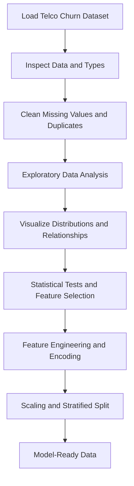

# Telco Customer Churn — Exploratory Data Analysis & Preprocessing

This project explores a telecommunications customer churn dataset and prepares it for machine learning. It covers **exploratory data analysis (EDA)**, data cleaning, visualizations, statistical testing, feature engineering, and preprocessing using Python.

## Project Goals

- Understand customer characteristics and identify potential churn patterns.
- Inspect data quality, missing values, duplicates, and data types.
- Explore relationships between individual features and customer churn.
- Prepare numeric and categorical variables for reliable modeling.
- Split the data into training and testing sets while preserving the churn distribution.

## Workflow



## Datasets

| Tasks | Dataset | Purpose |
| --- | --- | --- |
| **0–5** | `Telco-Customer-Churn.rar` | Initial inspection, cleaning, and exploration |
| **6–18** | `precleaned-Telco-Customer-Churn.rar` | Further analysis and preprocessing |

Download both datasets from the project resources, extract the archives, and use the resulting files for the corresponding tasks.

## Main Concepts

**Data cleaning:** Identify and handle missing values, correct column types, remove duplicates, and decide when records or columns should be dropped.

**EDA and visualization:** Use summary statistics, distribution plots, target-class counts, and correlation heatmaps to understand the dataset and spot patterns that may inform feature engineering.

**Statistical analysis:** Explore feature relationships with tests such as the Chi-square test for categorical variables and Welch's t-test for comparing numerical features across groups, where their assumptions are appropriate.

**Feature preprocessing:** Create or bin features, encode categorical columns, scale numerical columns, and use stratified train/test splitting to preserve the target proportions.

## Technologies

- **Python 3.11** — Programming language
- **NumPy 2.0.2, pandas 2.2.2** — Data handling and transformation
- **Matplotlib 3.10.0, seaborn 0.13.2** — Visualizations
- **SciPy 1.16.0** — Statistical testing
- **scikit-learn 1.6.1** — Preprocessing and data splitting
- **Pillow 11.3.0** — Image support

## Setup

Create an environment and install the required package versions:

```bash
python3 -m venv .venv
source .venv/bin/activate
python3 -m pip install \
  numpy==2.0.2 pandas==2.2.2 scikit-learn==1.6.1 \
  matplotlib==3.10.0 seaborn==0.13.2 scipy==1.16.0 pillow==11.3.0
```

On Windows, activate the environment using `.venv\Scripts\activate` instead.

Extract the datasets and execute each task's Python file using:

```bash
python3 <task_file>.py
```

Replace `<task_file>` with the filename for the task you want to run. Some tasks may define reusable functions rather than print output directly.

## Code Standards

Project scripts follow **pycodestyle 2.14.0** and the assignment requirements:

- Start every Python file with `#!/usr/bin/env python3`.
- Document every module, class, and function.
- End files with a newline and make scripts executable.
- Keep solutions compatible with the specified Python and library versions.

## Expected Outcome

By completing the tasks, the dataset should be better understood, key churn-related patterns explored, and its features cleaned and transformed into a form suitable for machine learning. **EDA can reveal associations, but it does not by itself establish causation.**
