<div align="center">

# MACHINE LEARNING

### From Structured Data to Intelligent Predictions

*Modeling · Optimization · Evaluation · Explainability*


[Overview](#01--overview) ·
[Architecture](#02--machine-learning-pipeline) ·
[Models](#03--model-architecture) ·
[Evaluation](#04--evaluation-framework) ·
[Explainability](#05--model-explainability) ·
[Setup](#08--getting-started)

[← Main Repository](../README.md)

</div>

---

## 01 — Overview

Machine learning begins where traditional data analysis ends.

This section explores the mathematical foundations, practical implementation and evaluation of supervised learning algorithms, transforming structured datasets into predictive and interpretable models.

The objective is not simply to produce predictions, but to understand:

- Which algorithm best represents the underlying data?
- How well does a model generalize to unseen observations?
- How can overfitting be identified and controlled?
- Which features contribute most to individual predictions?
- What trade-offs exist between complexity, performance and interpretability?

<div align="center">

| Learning Paradigms | Algorithm Families | Explainability |
|:---:|:---:|:---:|
| Regression & Classification | Linear, Kernel & Tree-Based | SHAP & Feature Importance |

</div>

### Repository Navigation

| Module | Focus | Dataset / Input | Explore |
|---|---|---|---|
| **Linear Models** | Regression, regularization, classification, SVM | NumPy arrays | [Open Module →](linear_models/README.md) |
| **Tree Models** | Decision trees, pruning, bagging, boosting | Wine dataset | [Open Module →](tree_models/README.md) |
| **Data Analysis** | Data preparation and exploration | Raw datasets | [Open Module →](../data_analysis/README.md) |

---

## 02 — Machine Learning Pipeline

Every experiment follows a structured workflow, from data preparation to model interpretation.

```mermaid
flowchart LR
    A["Raw Data"] --> B["Data Analysis"]
    B --> C["Feature Preparation"]
    C --> D["Train / Test Split"]

    D --> E["Model Training"]
    D --> F["Unseen Test Data"]

    E --> G["Cross-Validation"]
    G --> H["Hyperparameter Tuning"]
    H --> I["Final Model"]

    I --> J["Predictions"]
    F --> J

    J --> K["Evaluation"]
    I --> L["Explainability"]

    K --> M["Model Assessment"]
    L --> M

    classDef data fill:#1E293B,stroke:#64748B,color:#FFFFFF
    classDef process fill:#164E63,stroke:#22D3EE,color:#FFFFFF
    classDef model fill:#312E81,stroke:#818CF8,color:#FFFFFF
    classDef output fill:#14532D,stroke:#4ADE80,color:#FFFFFF

    class A,B,C,D,F data
    class E,G,H process
    class I,J model
    class K,L,M output
```

> **Core principle:** A successful model must generalize beyond its training data. High training performance alone is not sufficient evidence of predictive reliability.

### Experimental Lifecycle

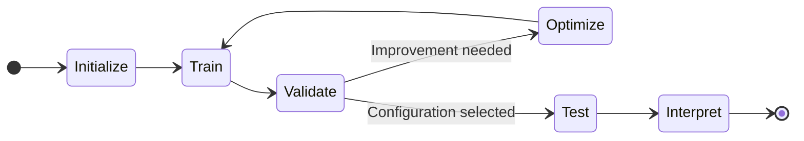

Training and optimization are performed using training and validation data. The test set remains isolated until final evaluation.

---

## 03 — Model Architecture

The repository investigates multiple approaches to supervised learning, progressing from interpretable statistical models to nonlinear ensemble architectures.

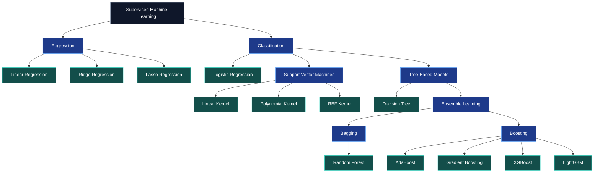

### 3.1 — Linear Models

[Explore Linear Models →](linear_models/README.md)

Linear models establish an interpretable foundation for understanding relationships between input variables and target outcomes.

<details>
<summary><b>Ordinary Least Squares — Mathematical Foundation</b></summary>

<br>

Linear regression models a continuous target as a weighted combination of input features.

$$
\hat{y} = \beta_0 + \sum_{j=1}^{p}\beta_jx_j
$$

The objective is to minimize the residual sum of squares:

$$
\mathcal{L}(\beta)=
\sum_{i=1}^{n}(y_i-\hat{y}_i)^2
$$

**Key concepts**

- Coefficient estimation
- Residual analysis
- Multicollinearity
- Model fit and generalization
- Continuous target prediction

</details>

<details>
<summary><b>Ridge & Lasso — Regularization</b></summary>

<br>

Regularization modifies the optimization objective to penalize overly complex models.

**Ridge — L2 Regularization**

$$
\mathcal{L}_{Ridge} =
RSS+\lambda\sum_{j=1}^{p}\beta_j^2
$$

**Lasso — L1 Regularization**

$$
\mathcal{L}_{Lasso} =
RSS+\lambda\sum_{j=1}^{p}|\beta_j|
$$

| Property | Ridge | Lasso |
|---|---|---|
| Penalty | L2 | L1 |
| Coefficient shrinkage | Yes | Yes |
| Exact zero coefficients | Generally no | Possible |
| Feature selection | No | Yes |
| Multicollinearity control | Yes | Yes |

Increasing regularization generally reduces model flexibility, potentially trading lower variance for higher bias.

</details>

<details>
<summary><b>Logistic Regression — Probability-Based Classification</b></summary>

<br>

Logistic regression maps a linear combination of features into a probability using the sigmoid function.

$$
P(y=1\mid x)=\frac{1}{1+e^{-z}}
$$

$$
z=\beta_0+\beta^Tx
$$

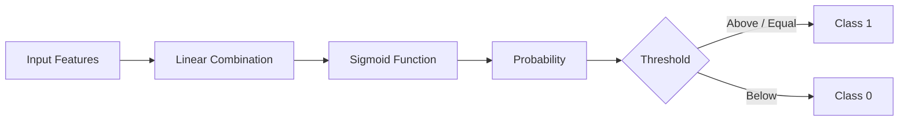

The decision threshold converts predicted probabilities into discrete class labels.

</details>

<details>
<summary><b>Support Vector Machines — Maximum Margin Learning</b></summary>

<br>

Support Vector Machines construct decision boundaries that maximize the margin between classes.

| Kernel | Decision Boundary | Primary Use |
|---|---|---|
| Linear | Linear hyperplane | Approximately linearly separable data |
| Polynomial | Polynomial boundary | Feature interactions |
| RBF | Flexible nonlinear boundary | Complex class distributions |

The kernel trick enables nonlinear classification by implicitly representing observations in a higher-dimensional feature space.

</details>

---

### 3.2 — Tree-Based Models

[Explore Tree Models →](tree_models/README.md)

Tree-based algorithms recursively partition the feature space, capturing nonlinear relationships and feature interactions without requiring a predefined linear relationship.

#### Decision Tree Structure

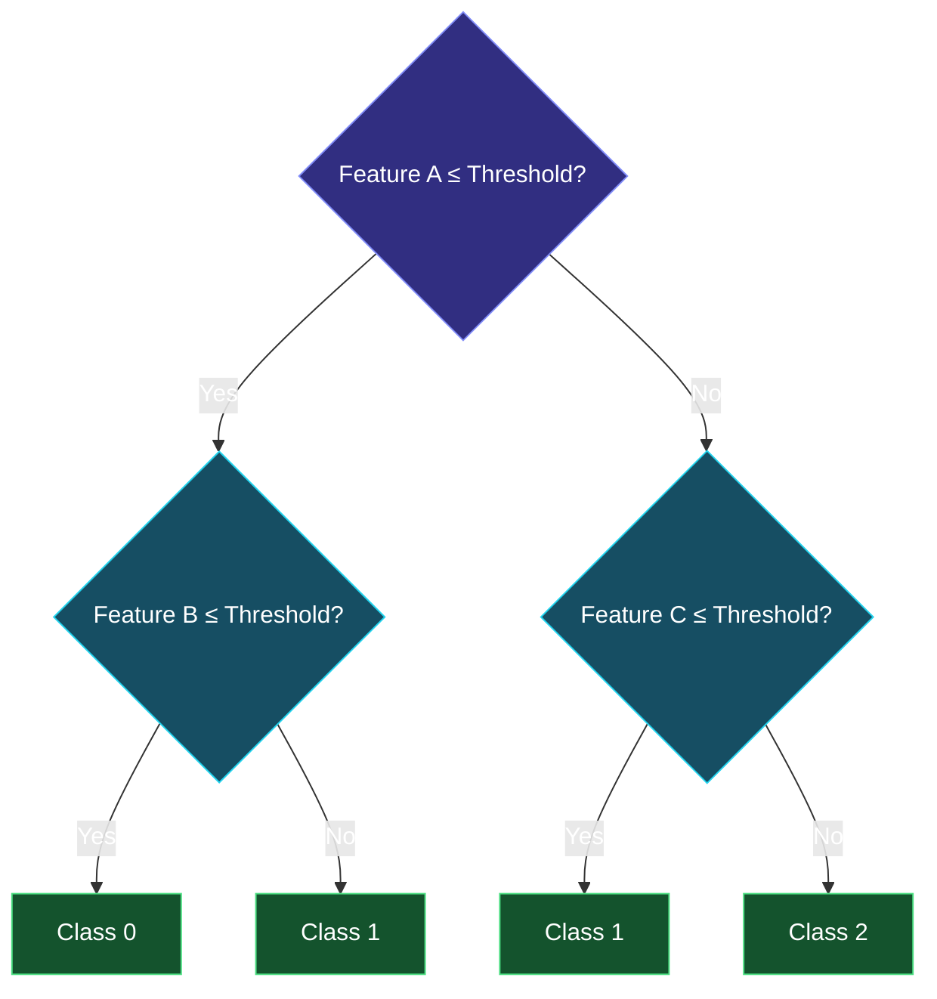

*Illustrative decision tree, not an experimental output.*

<details>
<summary><b>Decision Trees — Splitting Criteria</b></summary>

<br>

Decision trees select feature splits that improve the purity of resulting groups.

**Gini Impurity**

$$
Gini(S)=1-\sum_{k=1}^{K}p_k^2
$$

**Entropy**

$$
H(S)=-\sum_{k=1}^{K}p_k\log_2(p_k)
$$

A good split reduces the weighted impurity of its child nodes.

</details>

<details>
<summary><b>Overfitting Control — Pre-Pruning & Post-Pruning</b></summary>

<br>

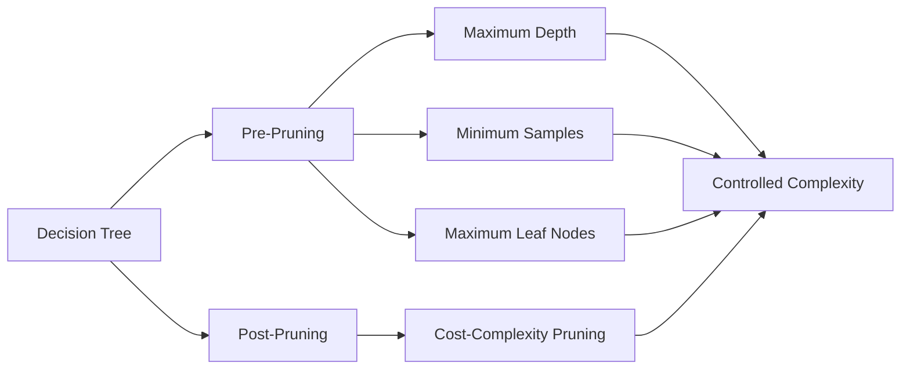

Cost-complexity pruning balances prediction error and tree complexity.

$$
R_{\alpha}(T)=R(T)+\alpha|\widetilde{T}|
$$

Where:

- $R(T)$ represents the tree's total leaf impurity.
- $\alpha$ controls the pruning strength.
- $|\widetilde{T}|$ represents the number of terminal nodes.

</details>

---

### 3.3 — Ensemble Learning

Ensemble methods combine multiple learners to improve predictive performance, stability and generalization.

#### Bagging vs. Boosting

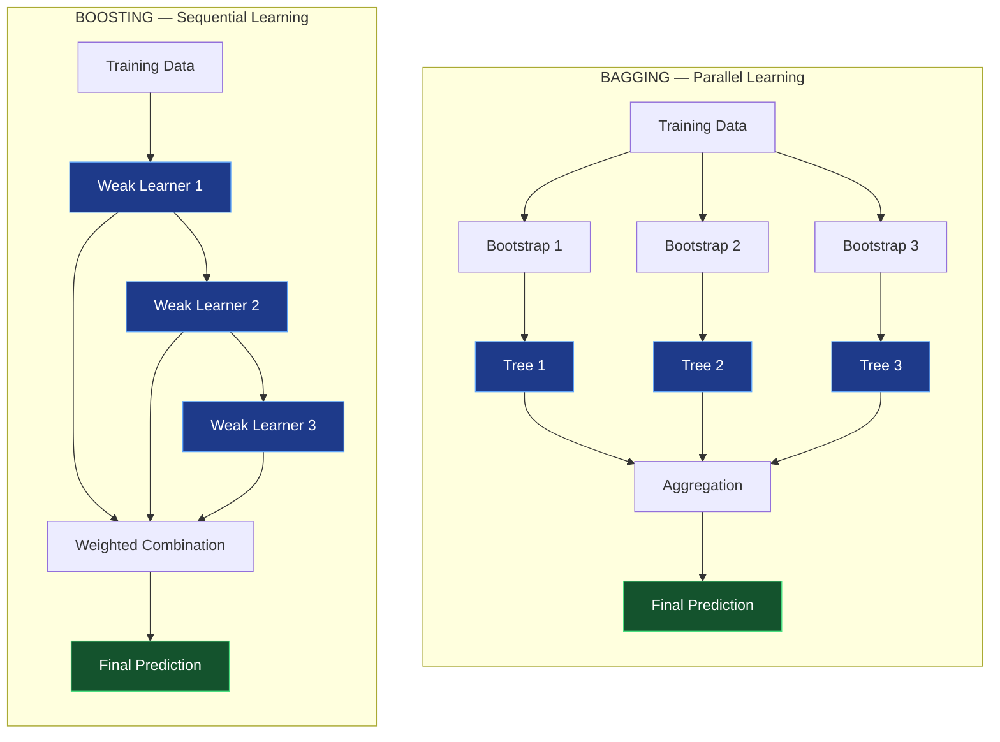

| Algorithm | Strategy | Core Advantage |
|---|---|---|
| Random Forest | Bagging | Variance reduction and robustness |
| AdaBoost | Sequential reweighting | Focus on difficult observations |
| Gradient Boosting | Gradient-based optimization | Flexible loss minimization |
| XGBoost | Regularized gradient boosting | Complexity control and efficiency |
| LightGBM | Histogram-based gradient boosting | Computational scalability |

---

## 04 — Evaluation Framework

Different prediction problems require different evaluation strategies.

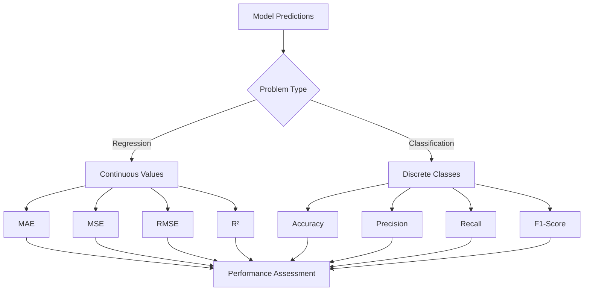

### Regression Metrics

| Metric | Interpretation | Optimization |
|---|---|:---:|
| MAE | Average absolute prediction error | ↓ |
| MSE | Average squared prediction error | ↓ |
| RMSE | Error expressed in original target units | ↓ |
| R² | Fit relative to a mean-prediction baseline | ↑ |

### Classification Metrics

| Metric | Interpretation | Optimization |
|---|---|:---:|
| Accuracy | Proportion of correct predictions | ↑ |
| Precision | Reliability of positive predictions | ↑ |
| Recall | Proportion of actual positives identified | ↑ |
| F1-Score | Harmonic mean of precision and recall | ↑ |

<details>
<summary><b>View Mathematical Definitions</b></summary>

<br>

$$
MAE=\frac{1}{n}\sum_{i=1}^{n}|y_i-\hat{y}_i|
$$

$$
MSE=\frac{1}{n}\sum_{i=1}^{n}(y_i-\hat{y}_i)^2
$$

$$
RMSE=\sqrt{MSE}
$$

$$
R^2=1-\frac{\sum_i(y_i-\hat{y}_i)^2}
{\sum_i(y_i-\bar{y})^2}
$$

$$
Precision=\frac{TP}{TP+FP}
$$

$$
Recall=\frac{TP}{TP+FN}
$$

$$
F_1=2\cdot\frac{Precision\cdot Recall}
{Precision+Recall}
$$

</details>

### Cross-Validation & Hyperparameter Optimization

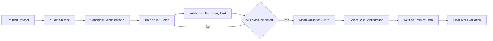

Grid search systematically evaluates predefined hyperparameter combinations using cross-validation.

> Preprocessing and feature selection must be fitted within the training folds to prevent data leakage.

---

## 05 — Model Explainability

Predictive accuracy answers **how well** a model performs.

Explainability addresses **why** it produces particular predictions.

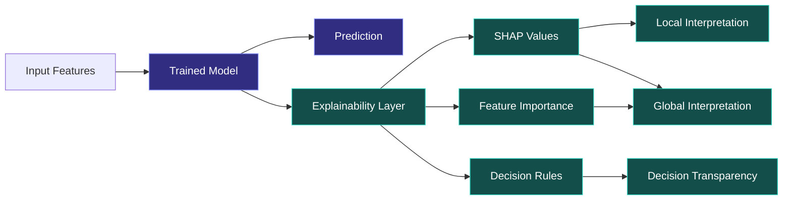

### SHAP — SHapley Additive exPlanations

SHAP attributes a model prediction to individual input features relative to a baseline prediction.

$$
f(x)=\phi_0+\sum_{j=1}^{p}\phi_j
$$

Where:

- $\phi_0$ is the baseline model output.
- $\phi_j$ is the contribution of feature $j$.
- $f(x)$ is the explained model output, on the explainer's output scale.

<details>
<summary><b>Local vs. Global Explainability</b></summary>

<br>

| Local Explainability | Global Explainability |
|---|---|
| Explains individual predictions | Explains overall model behavior |
| Identifies feature contributions | Identifies influential features |
| Investigates unexpected predictions | Reveals systematic patterns |
| Individual SHAP values | SHAP beeswarm and importance plots |

</details>

<details>
<summary><b>Interpretation Methods Used in This Repository</b></summary>

<br>

- Linear model coefficients
- Lasso-based feature selection
- Decision tree rule extraction
- Random forest feature importance
- SHAP feature contributions
- SHAP beeswarm visualizations

Feature importance and SHAP contributions describe model behavior. They do not independently establish causal relationships.

</details>

---

## 06 — Algorithm Comparison

The following comparison describes general algorithm characteristics rather than measured benchmark results.

| Algorithm | Nonlinear | Interpretability | Complexity Control | Scaling Important |
|---|:---:|:---:|:---:|:---:|
| Linear Regression | No | High | Limited | Sometimes |
| Ridge | No | High | L2 | Yes |
| Lasso | No | High | L1 | Yes |
| Logistic Regression | No* | High | Regularization | Yes |
| SVM | Kernel-dependent | Medium–Low | C / Kernel | Yes |
| Decision Tree | Yes | High** | Pruning | No |
| Random Forest | Yes | Medium–Low | Ensembling / Tree limits | No |
| AdaBoost | Yes*** | Low | Learning rate / Estimators | Usually no |
| Gradient Boosting | Yes | Low | Depth / Learning rate | No |
| XGBoost | Yes | Low | Regularization / Tree limits | No |
| LightGBM | Yes | Low | Leaf / Tree constraints | No |

<sub>
*Linear decision boundary with untransformed features.
**For sufficiently small trees.
***When using nonlinear base learners.
</sub>

### Understanding Model Complexity

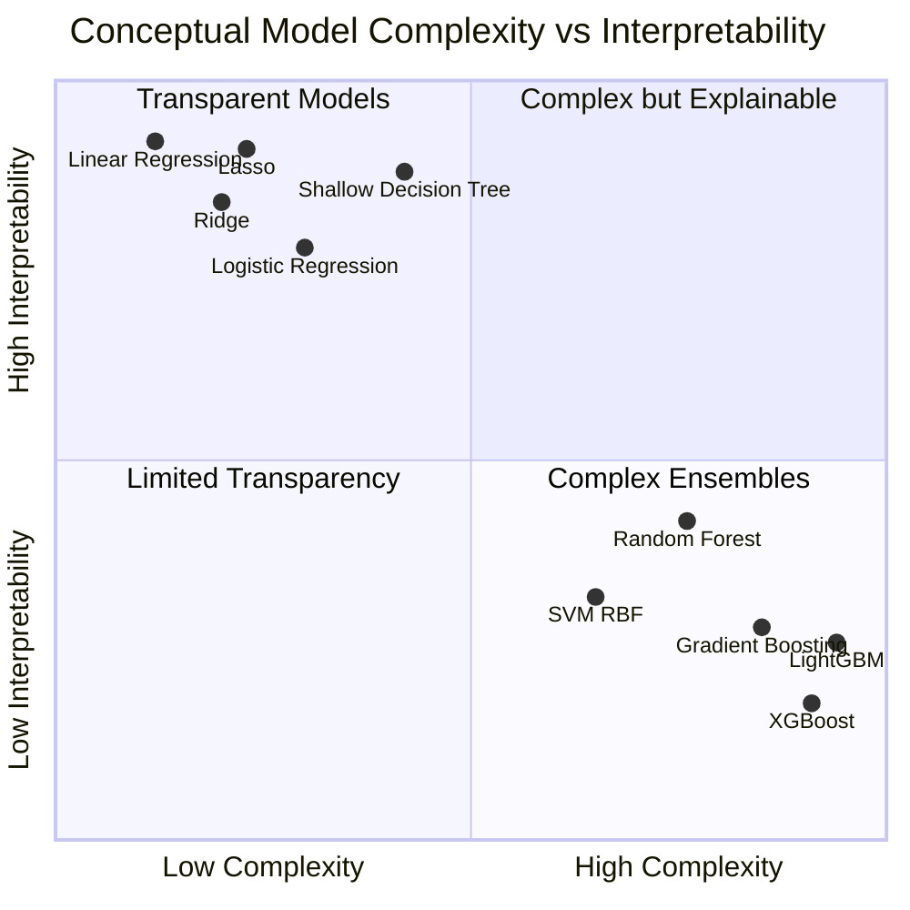

<sub>Illustrative positioning only. Complexity and interpretability depend on the specific model configuration and dataset.</sub>

---

## 07 — Learning Roadmap

The modules are organized around a progressive development of machine learning capabilities.

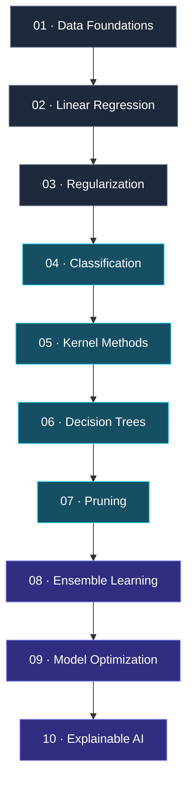

<details>
<summary><b>Technical Skills — Expand Competency Map</b></summary>

<br>

| Domain | Skills |
|---|---|
| Mathematical Foundations | Loss functions, optimization objectives, regularization |
| Statistical Learning | Regression, classification, multicollinearity |
| Model Development | Estimator initialization, fitting, prediction |
| Validation | Train/test separation, cross-validation |
| Optimization | Hyperparameter tuning, grid search |
| Generalization | Bias-variance trade-off, pruning, regularization |
| Ensemble Methods | Bagging, boosting, gradient boosting |
| Explainable AI | SHAP, feature importance, decision rules |
| Technical Judgment | Model selection, performance interpretation |

</details>

---

## 08 — Getting Started

### Repository Structure

```text
machine_learning/
│
├── linear_models/
│   └── README.md
│
├── tree_models/
│   └── README.md
│
└── README.md
```

### Environment Setup

Create an isolated Python environment.

```bash
python -m venv .venv
```

Activate the environment.

**Linux / macOS**

```bash
source .venv/bin/activate
```

**Windows PowerShell**

```powershell
.venv\Scripts\Activate.ps1
```

Install the required dependencies.

```bash
python -m pip install numpy scikit-learn matplotlib shap xgboost lightgbm
```

### Technology Stack

<div align="center">


</div>

| Technology | Responsibility |
|---|---|
| NumPy | Numerical computing and array operations |
| Scikit-learn | Model development and evaluation |
| Matplotlib | Statistical and model visualizations |
| SHAP | Prediction explainability |
| XGBoost | Regularized gradient boosting |
| LightGBM | Efficient gradient boosting |

---

## 09 — Experimental Principles

> Build models that generalize, not models that merely memorize.

The experiments in this repository are guided by five principles:

| Principle | Objective |
|---|---|
| **Data Integrity** | Prevent leakage and preserve valid evaluation |
| **Reproducibility** | Produce consistent, traceable experiments |
| **Generalization** | Evaluate performance on unseen observations |
| **Interpretability** | Understand the reasoning behind predictions |
| **Scientific Judgment** | Select models based on evidence rather than complexity |

---

<div align="center">

## Continue Exploring

<table>
<tr>
<td align="center" width="50%">

### Linear Models

Regression, regularization, classification and kernel methods.

[**Explore Linear Models →**](linear_models/README.md)

</td>
<td align="center" width="50%">

### Tree Models

Decision trees, pruning, random forests and boosting.

[**Explore Tree Models →**](tree_models/README.md)

</td>
</tr>
</table>

---

**DATA → MODEL → VALIDATION → INSIGHT**

*Learning the mathematics. Building the models. Understanding the predictions.*

[Main Repository](../README.md) · [Data Analysis](../data_analysis/README.md)

</div>
