<div align="center">

# LINEAR MODELS & KERNEL METHODS

### Statistical Learning · Regularization · Decision Boundaries · Explainable AI


[Overview](#01--overview) ·
[Architecture](#02--learning-architecture) ·
[Algorithms](#03--mathematical-foundations) ·
[Experiments](#04--experimental-results) ·
[Explainability](#05--explainable-ai) ·
[Implementation](#06--implementation) ·
[Setup](#08--getting-started)

[← Machine Learning](../README.md) · [Main Repository](../../README.md)

---


</div>

## 01 — Overview

Linear models represent one of the fundamental building blocks of machine learning.

This module investigates how statistical learning algorithms transform numerical features into continuous predictions and class probabilities, how regularization improves generalization, and how kernel methods overcome the limitations of linear decision boundaries.

The implementation consists of seven interconnected tasks using synthetic datasets designed to expose specific statistical and computational challenges.

<div align="center">

| Implementations | Model Configurations | Evaluation Metrics | Explainability Framework |
|:---:|:---:|:---:|:---:|
| **7** | **7** | **5** | **SHAP** |

</div>

### Research Questions

| Challenge | Approach |
|---|---|
| How can we estimate continuous relationships? | Ordinary Least Squares |
| How can we stabilize correlated coefficients? | Ridge Regularization |
| How can we identify relevant features? | Lasso Regularization |
| How can we measure prediction quality? | Regression and classification metrics |
| How can we interpret individual predictions? | SHAP |
| How can we estimate class membership? | Logistic Regression |
| How can we capture nonlinear decision boundaries? | SVM Kernel Methods |

> A model is not defined solely by its predictive performance, but also by its generalization, stability and interpretability.

---

## 02 — Learning Architecture

The tasks are organized into three interconnected components: regression, classification and model interpretation.

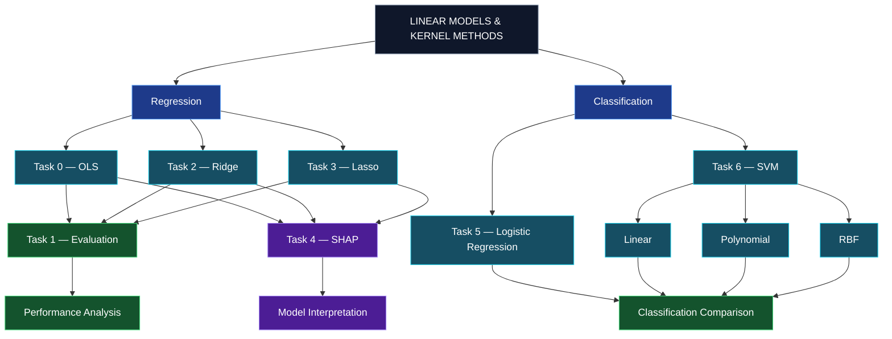

### Experimental Workflow


Each model constructor returns an unfitted estimator, allowing training, prediction and evaluation to be managed independently.

---

## 03 — Mathematical Foundations

### 3.1 Ordinary Least Squares

**Task 00 · Baseline Regression**

Ordinary Least Squares estimates a linear relationship between input features and a continuous target variable.

$$
\hat{y}=\beta_0+\sum_{j=1}^{p}\beta_jx_j
$$

The model minimizes the residual sum of squares:

$$
\hat{\beta}=
\arg\min_{\beta}
\sum_{i=1}^{n}(y_i-\hat{y}_i)^2
$$

<details>
<summary><b>Explore the mathematical formulation</b></summary>

<br>

In matrix notation:

$$
y=X\beta+\epsilon
$$

When the design matrix has full column rank, the analytical solution is:

$$
\hat{\beta}=(X^TX)^{-1}X^Ty
$$

However, highly correlated features can make the matrix poorly conditioned, producing unstable coefficient estimates.

**Advantages**

- Simple mathematical formulation.
- Computationally efficient.
- Direct coefficient interpretation.
- Useful as a regression baseline.

**Limitations**

- Sensitive to influential outliers.
- Unstable under strong multicollinearity.
- Cannot directly capture nonlinear relationships without feature transformations.

</details>


[View Implementation →](0-linear_regression.py)

---

### 3.2 Ridge Regression

**Task 02 · L2 Regularization**

Ridge regression extends ordinary least squares by introducing a penalty on the squared magnitude of the coefficients.

$$
\hat{\beta}_{Ridge}
=
\arg\min_{\beta}
\left[
\|y-X\beta\|_2^2+
\alpha\|\beta\|_2^2
\right]
$$

The regularization parameter controls the balance between prediction error and coefficient magnitude.

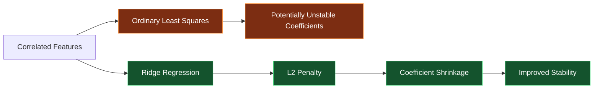

<details>
<summary><b>Why does Ridge handle multicollinearity?</b></summary>

<br>

Multicollinearity occurs when two or more input variables contain strongly overlapping information.

Ordinary least squares may assign large and opposing coefficients to correlated features, producing unstable estimates.

Ridge reduces this sensitivity by penalizing large coefficient values.

Its matrix solution, assuming centered data and an unpenalized intercept, is:

$$
\hat{\beta}_{Ridge}
=
(X^TX+\alpha I)^{-1}X^Ty
$$

The additional diagonal term improves numerical conditioning when the regularization parameter is positive.

Ridge generally shrinks coefficients without setting them exactly to zero.

</details>

[View Implementation →](2-ridge_regression.py)

---

### 3.3 Lasso Regression

**Task 03 · L1 Regularization & Feature Selection**

Lasso introduces an absolute-value penalty that can force individual coefficients to become exactly zero.

$$
\hat{\beta}_{Lasso}
=
\arg\min_{\beta}
\left[
\frac{1}{2n}\|y-X\beta\|_2^2+
\alpha\|\beta\|_1
\right]
$$

This makes Lasso both a predictive algorithm and an embedded feature-selection method.

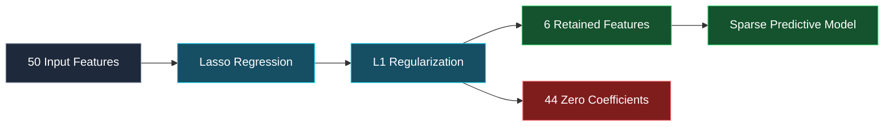

<details>
<summary><b>How does Lasso perform feature selection?</b></summary>

<br>

The L1 penalty encourages sparsity in the coefficient vector.

Features whose coefficients become zero no longer contribute directly to the model's prediction.

For the provided synthetic experiment:

- Total input features: 50
- Informative features: 5
- Retained features: 6
- Zero coefficients: 44
- Feature reduction: 88%

Lasso does not guarantee that all retained features are genuinely informative. Its selection depends on the dataset, regularization strength and relationships between features.

</details>

[View Implementation →](3-Lasso_regression.py)

---

### Regularization Comparison

| Property | OLS | Ridge | Lasso |
|---|:---:|:---:|:---:|
| Penalty | None | L2 | L1 |
| Coefficient shrinkage | No | Yes | Yes |
| Sparse coefficients | No | Generally no | Yes |
| Embedded feature selection | No | No | Yes |
| Multicollinearity control | Limited | Strong | Possible |
| Regularization parameter | None | Alpha | Alpha |

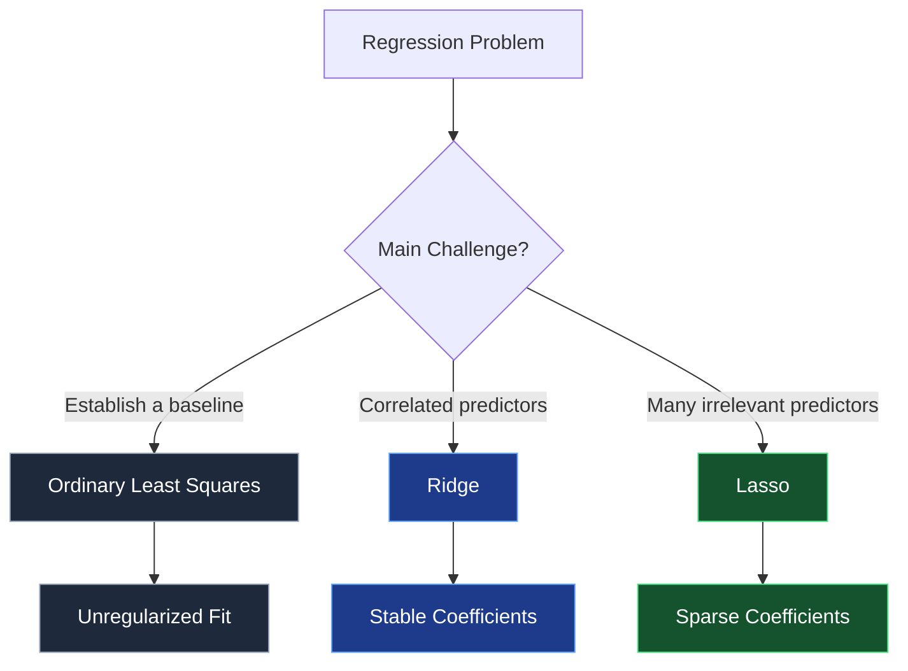

*Conceptual model-selection guide. Final model selection should be based on validation performance.*

---

### 3.4 Logistic Regression

**Task 05 · Probabilistic Classification**

Despite its name, logistic regression is a classification algorithm.

It transforms a linear decision function into a probability using the sigmoid function.

$$
z=\beta_0+\beta^Tx
$$

$$
P(y=1|x)=\sigma(z)=\frac{1}{1+e^{-z}}
$$

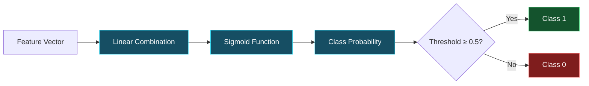

<details>
<summary><b>Explore the sigmoid activation function</b></summary>

<br>

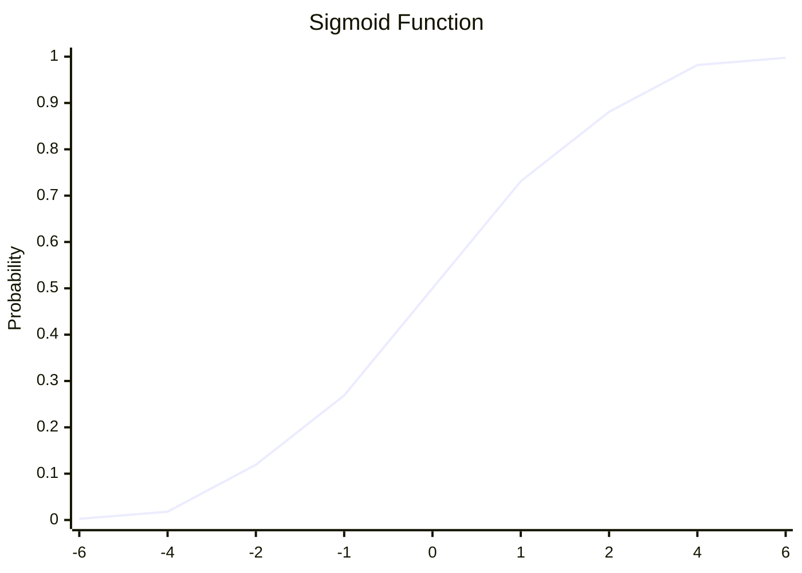

The sigmoid maps any real-valued number into a probability between zero and one.

For binary classification, a default threshold of 0.5 separates the two predicted classes.

The binary cross-entropy loss is:

$$
\mathcal{L}
=
-\frac{1}{n}
\sum_{i=1}^{n}
\left[
y_i\log(\hat{p}_i)
+
(1-y_i)\log(1-\hat{p}_i)
\right]
$$

The model learns coefficients that minimize its classification objective, including regularization when enabled.

</details>

[View Implementation →](5-logisitc_regression.py)

---

### 3.5 Support Vector Machines

**Task 06 · Maximum-Margin Classification**

Support Vector Machines construct decision boundaries by maximizing the margin between classes.

Kernel functions allow the model to represent nonlinear relationships without explicitly computing all transformed features.

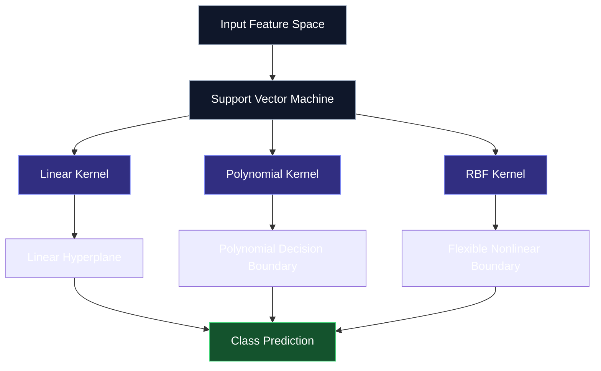

<details>
<summary><b>Linear Kernel — Mathematical Definition</b></summary>

<br>

$$
K(x_i,x_j)=x_i^Tx_j
$$

The linear kernel measures similarity through the dot product of two feature vectors.

It produces a linear decision boundary and is particularly useful when classes are approximately linearly separable.

</details>

<details>
<summary><b>Polynomial Kernel — Mathematical Definition</b></summary>

<br>

$$
K(x_i,x_j)=
(\gamma x_i^Tx_j+r)^d
$$

The polynomial kernel introduces higher-order feature interactions.

Its behavior depends on:

- Polynomial degree.
- Kernel coefficient gamma.
- Independent coefficient.
- Regularization parameter C.

</details>

<details>
<summary><b>Radial Basis Function — Mathematical Definition</b></summary>

<br>

$$
K(x_i,x_j)=
\exp(-\gamma\|x_i-x_j\|^2)
$$

The RBF kernel measures similarity based on the distance between observations.

Nearby observations have higher similarity, while distant observations have lower similarity.

This enables the model to construct highly flexible nonlinear decision boundaries.

</details>

| Kernel | Decision Boundary | Flexibility | Key Parameters |
|---|---|:---:|---|
| Linear | Linear hyperplane | Low | C |
| Polynomial | Polynomial boundary | Medium–High | C, degree, gamma, coef0 |
| RBF | Flexible nonlinear boundary | High | C, gamma |

[View Implementation →](6-svm.py)

---

## 04 — Experimental Results

The following results are obtained from the provided synthetic-data examples.

They demonstrate algorithm behavior under controlled conditions rather than universal performance rankings.

### 4.1 Baseline Regression

<div align="center">

| Model | RMSE | R² |
|:---:|:---:|:---:|
| Linear Regression | **4.95** | **0.827** |

</div>

The baseline establishes a reference point for evaluating the regularized regression models.

---

### 4.2 Ridge — Multicollinearity Experiment

**Scenario:** Two nearly identical features.

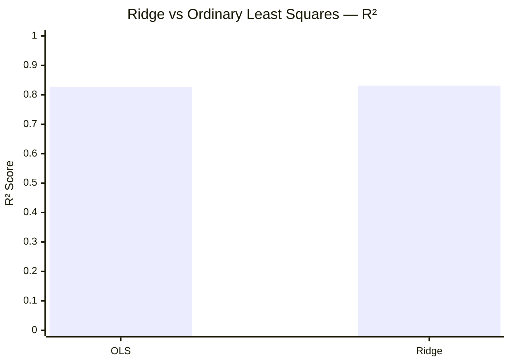

| Model | R² |
|---|---:|
| Ordinary Least Squares | 0.827 |
| Ridge Regression | **0.831** |

**Observed difference:** +0.004 R², equivalent to 0.4 percentage points on a percentage-scaled R² score.

The results show a small predictive improvement with Ridge.

The primary theoretical advantage of Ridge in this experiment is coefficient stabilization rather than necessarily a large increase in predictive accuracy.

---

### 4.3 Lasso — Feature Selection Experiment

**Scenario:** 50 input features, of which only 5 are informative.

<div align="center">

| Baseline R² | Lasso R² | Feature Reduction |
|:---:|:---:|:---:|
| **0.489** | **0.819** | **88%** |

</div>

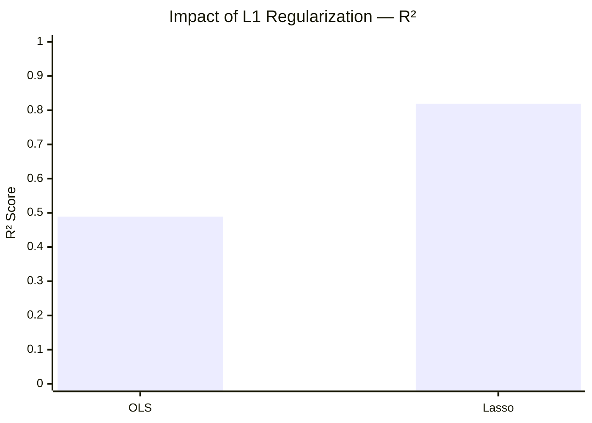

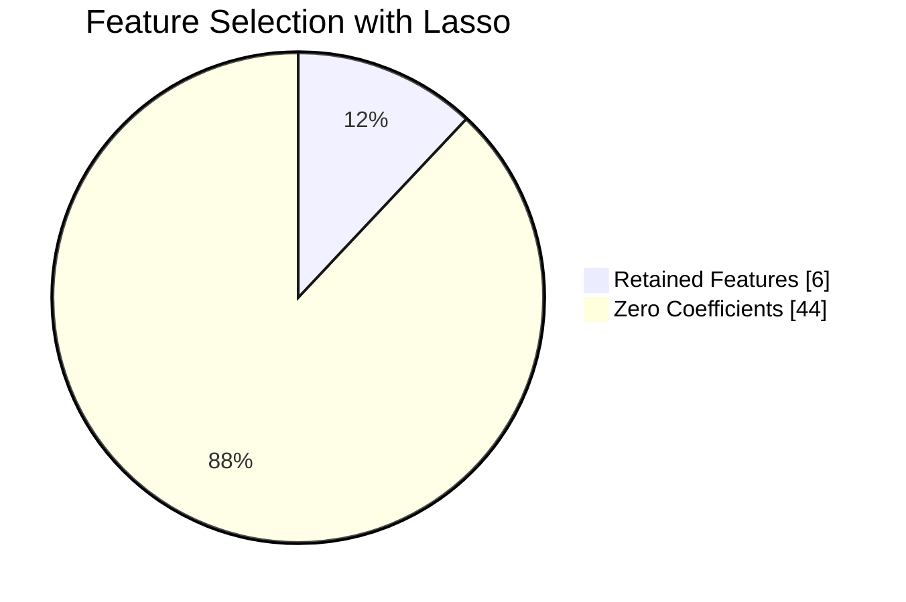

| Indicator | Result |
|---|---:|
| Original features | 50 |
| Informative features | 5 |
| Retained features | 6 |
| Zero coefficients | 44 |
| Feature reduction | 88% |
| Absolute R² improvement | +0.330 |

The regularized model achieves substantially better predictive performance while using considerably fewer features.

> This experiment illustrates how irrelevant features can negatively affect generalization and how regularization can help control model complexity.

---

### 4.4 Logistic Regression — Binary Classification

**Scenario:** Two informative features and two classes.

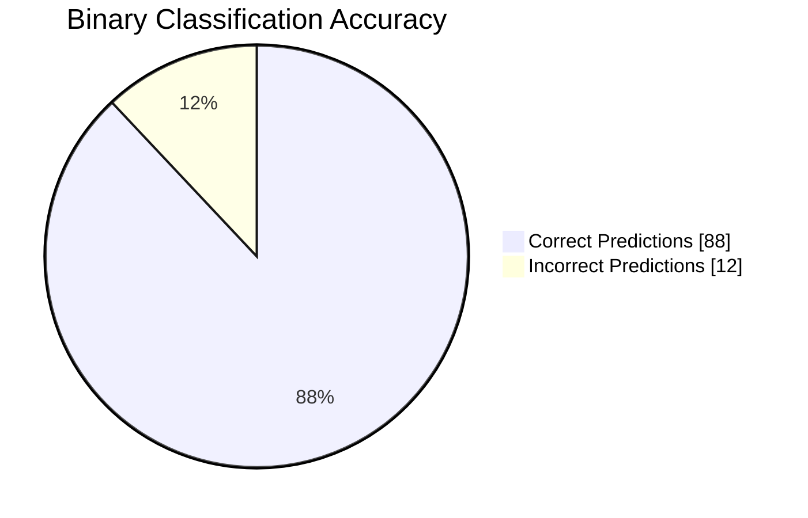

<div align="center">

| Accuracy | Error Rate |
|:---:|:---:|
| **88%** | **12%** |

</div>

The model performs well in this particular binary classification setup, where a linear decision boundary is sufficiently effective.

---

### 4.5 SVM — Nonlinear Classification

**Scenario:** Three concentric classes.

Concentric class distributions expose the limitations of linear classification algorithms.

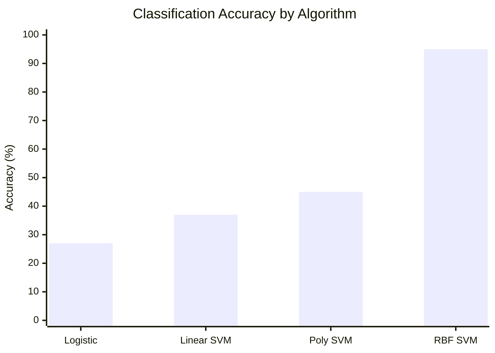

| Algorithm | Accuracy | Error Rate |
|---|---:|---:|
| Logistic Regression | 27% | 73% |
| Linear SVM | 37% | 63% |
| Polynomial SVM | 45% | 55% |
| **RBF SVM** | **95%** | **5%** |

<div align="center">

| Best Model | Accuracy Improvement vs Logistic |
|:---:|:---:|
| **RBF SVM** | **+68 Percentage Points** |

</div>

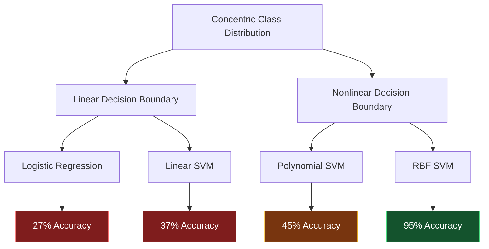

<details>
<summary><b>Why does the RBF kernel perform better?</b></summary>

<br>

The concentric classes cannot be effectively separated using straight decision boundaries.

Logistic regression and linear SVM are restricted to linear decision functions in the original feature space.

The RBF kernel introduces distance-based similarity, allowing the SVM to represent curved boundaries that better match the geometry of the data.

The experiment demonstrates that model selection should consider the underlying feature distribution, rather than relying only on algorithm popularity.

The reported results depend on the synthetic dataset and model configuration.

</details>

---

## 05 — Explainable AI

### SHAP — SHapley Additive exPlanations

**Task 04 · Model Interpretation**

SHAP explains a model prediction by assigning an individual contribution to every input feature relative to a baseline model output.

$$
f(x)=\phi_0+\sum_{j=1}^{p}\phi_j
$$

Where:

- $\phi_0$ represents the baseline model output.
- $\phi_j$ represents the contribution of feature $j$.
- $f(x)$ represents the explained model output.

### Explainability Architecture

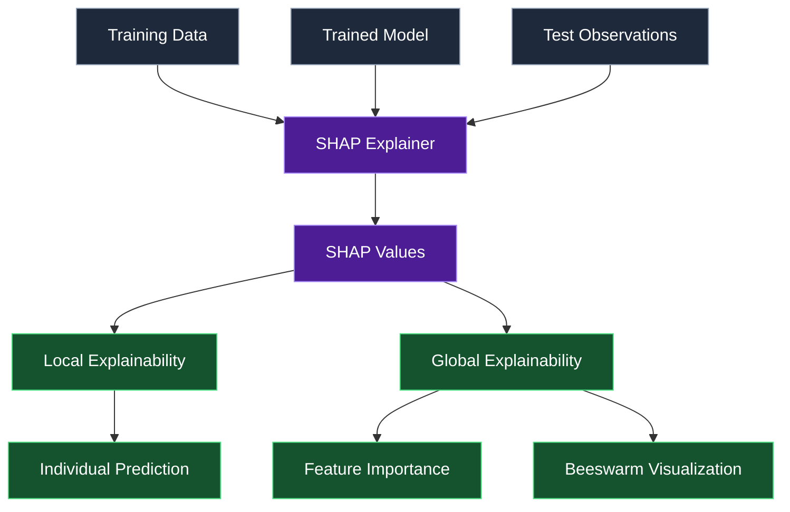

### Understanding a Prediction

The following values are illustrative and demonstrate how feature contributions combine with a baseline prediction.


<details>
<summary><b>Local vs. Global Explainability</b></summary>

<br>

| Local Explainability | Global Explainability |
|---|---|
| Explains one prediction | Explains overall model behavior |
| Individual feature contributions | Aggregated feature contributions |
| Investigates unusual predictions | Identifies systematic patterns |
| Waterfall or force plots | Beeswarm and importance plots |

SHAP describes how a trained model uses its features. It does not establish causal relationships between variables.

</details>

<details>
<summary><b>Why use training data as the background?</b></summary>

<br>

The background dataset establishes a reference distribution against which predictions are explained.

Using training data avoids defining the reference directly from the test observations being evaluated.

The implemented function:

1. Receives an already trained model.
2. Creates an explainer using training data.
3. Computes SHAP values for test observations.
4. Returns the explainer and computed SHAP values.

</details>

[View Implementation →](4-shap.py)

---

## 06 — Implementation

### Task Directory

| ID | Implementation | Objective |
|:---:|---|---|
| 00 | [Linear Regression](0-linear_regression.py) | Baseline continuous prediction |
| 01 | [Evaluation Metrics](1-regression_evaluation_metrics.py) | Regression performance measurement |
| 02 | [Ridge Regression](2-ridge_regression.py) | L2 regularization |
| 03 | [Lasso Regression](3-Lasso_regression.py) | L1 regularization and sparsity |
| 04 | [SHAP](4-shap.py) | Prediction interpretation |
| 05 | [Logistic Regression](5-logisitc_regression.py) | Probabilistic classification |
| 06 | [Support Vector Machines](6-svm.py) | Linear and nonlinear classification |

### Function Interface

<details>
<summary><b>Task 00 — Linear_Regression()</b></summary>

<br>

```python
Linear_Regression()
```

**Returns:** An unfitted `sklearn.linear_model.LinearRegression` estimator.

**Purpose:** Establish a baseline regression model.

</details>

<details>
<summary><b>Task 01 — evaluation_metrics_for_regression()</b></summary>

<br>

```python
evaluation_metrics_for_regression(y_true, y_pred)
```

**Parameters**

- `y_true`: Actual target values.
- `y_pred`: Predicted target values.

**Returns**

```python
(mse, rmse, mae, r2)
```

</details>

<details>
<summary><b>Task 02 — ridge_regression()</b></summary>

<br>

```python
ridge_regression(random_state)
```

**Returns:** An unfitted `Ridge` estimator.

**Purpose:** Stabilize regression coefficients using L2 regularization.

</details>

<details>
<summary><b>Task 03 — lasso_regression()</b></summary>

<br>

```python
lasso_regression(random_state)
```

**Returns:** An unfitted `Lasso` estimator.

**Purpose:** Apply L1 regularization and encourage sparse coefficients.

</details>

<details>
<summary><b>Task 04 — get_shap_explainer_and_values()</b></summary>

<br>

```python
get_shap_explainer_and_values(
    model,
    X_train,
    X_test
)
```

**Parameters**

- `model`: A trained model.
- `X_train`: Background training data.
- `X_test`: Observations to explain.

**Returns:** SHAP explainer and computed SHAP values.

</details>

<details>
<summary><b>Task 05 — Logistic_Regression_Model()</b></summary>

<br>

```python
Logistic_Regression_Model(random_state)
```

**Returns:** An unfitted `LogisticRegression` estimator.

**Purpose:** Estimate class probabilities and predict class membership.

</details>

<details>
<summary><b>Task 06 — get_SVM_model()</b></summary>

<br>

```python
get_SVM_model(name, random_state)
```

**Supported kernels**

```python
"linear"
"poly"
"rbf"
```

**Returns:** An unfitted `SVC` estimator.

**Exceptions:** Raises `ValueError` for unsupported kernel names.

</details>

---

### Task Dependencies

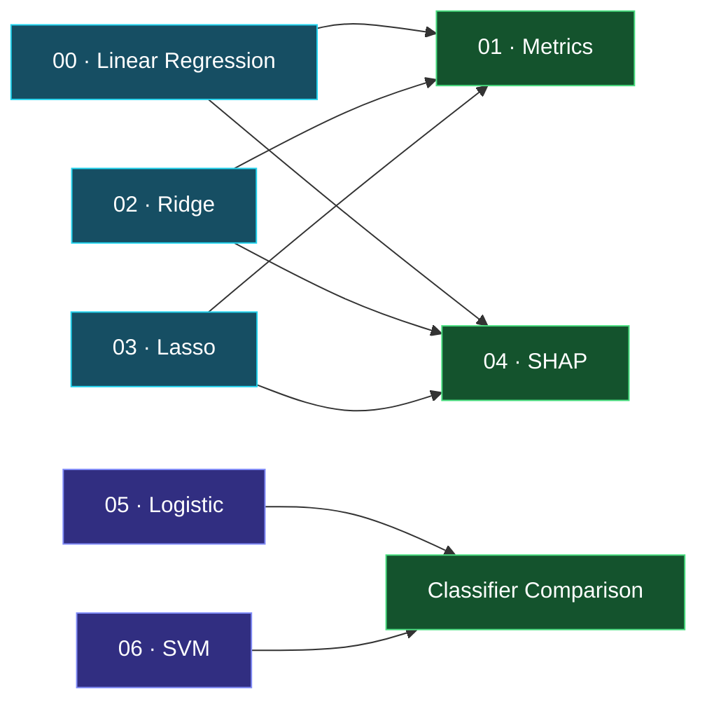

*Arrows indicate conceptual and experimental relationships, not necessarily direct Python imports.*

---

## 07 — Evaluation Framework

### Regression Metrics

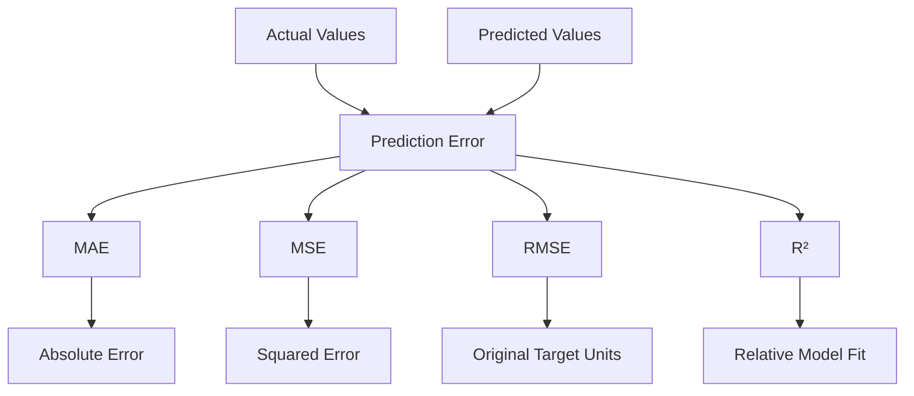

| Metric | Mathematical Meaning | Objective |
|---|---|:---:|
| MAE | Mean absolute error | Minimize |
| MSE | Mean squared error | Minimize |
| RMSE | Root mean squared error | Minimize |
| R² | Fit relative to a mean baseline | Maximize |
| Accuracy | Fraction of correct classifications | Maximize |

<details>
<summary><b>View mathematical definitions</b></summary>

<br>

**Mean Absolute Error**

$$
MAE=\frac{1}{n}\sum_{i=1}^{n}|y_i-\hat{y}_i|
$$

**Mean Squared Error**

$$
MSE=\frac{1}{n}\sum_{i=1}^{n}(y_i-\hat{y}_i)^2
$$

**Root Mean Squared Error**

$$
RMSE=\sqrt{MSE}
$$

**Coefficient of Determination**

$$
R^2=1-
\frac{\sum_i(y_i-\hat{y}_i)^2}
{\sum_i(y_i-\bar{y})^2}
$$

**Classification Accuracy**

$$
Accuracy=\frac{\text{Correct Predictions}}{\text{Total Predictions}}
$$

An R² value of 1 indicates perfect predictions. A negative value indicates performance worse than the mean-prediction reference.

</details>

[View Metrics Implementation →](1-regression_evaluation_metrics.py)

---

## 08 — Getting Started

### Directory Structure

```text
linear_models/
│
├── assets/
│   └── models.svg
│
├── 0-linear_regression.py
├── 1-regression_evaluation_metrics.py
├── 2-ridge_regression.py
├── 3-Lasso_regression.py
├── 4-shap.py
├── 5-logisitc_regression.py
├── 6-svm.py
│
└── README.md
```

### Environment Setup

Create an isolated Python environment:

```bash
python -m venv .venv
```

Activate the environment.

**Linux / macOS**

```bash
source .venv/bin/activate
```

**Windows PowerShell**

```powershell
.venv\Scripts\Activate.ps1
```

Install dependencies:

```bash
python -m pip install numpy scikit-learn matplotlib shap
```

### Running Experiments

The `N-main.py` scripts are provided with the original project and are not included in this repository.

Place the corresponding main script inside this directory and execute it:

```bash
python 3-main.py
```

### Example Usage

```python
from sklearn.model_selection import train_test_split

Linear_Regression = __import__(
    "0-linear_regression"
).Linear_Regression

evaluate = __import__(
    "1-regression_evaluation_metrics"
).evaluation_metrics_for_regression

# X and y represent the dataset.
X_train, X_test, y_train, y_test = train_test_split(
    X,
    y,
    test_size=0.2,
    random_state=42
)

model = Linear_Regression()

model.fit(X_train, y_train)

predictions = model.predict(X_test)

mse, rmse, mae, r2 = evaluate(
    y_test,
    predictions
)

print(f"MSE:  {mse:.4f}")
print(f"RMSE: {rmse:.4f}")
print(f"MAE:  {mae:.4f}")
print(f"R²:   {r2:.4f}")
```

> Run the examples from the `linear_models/` directory because the task modules use numbered filenames and dynamic imports.

### Implementation Conventions

- Model constructors return unfitted estimators.
- Training is performed externally using `.fit()`.
- Predictions are generated using `.predict()`.
- `random_state` is passed through where required.
- Unsupported SVM kernels raise `ValueError`.
- Feature scaling is recommended for regularized models and SVMs.
- Preprocessing should be fitted on training data only.

The filename `5-logisitc_regression.py` intentionally preserves the spelling required by the original main script.

---

## 09 — Key Findings

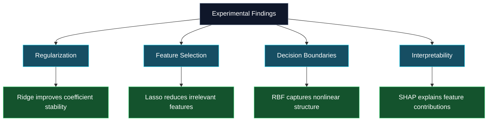

| Experiment | Main Observation |
|---|---|
| Ridge | Small R² improvement in the correlated-feature experiment |
| Lasso | Higher R² with 88% fewer nonzero feature coefficients |
| Logistic Regression | 88% accuracy on the binary classification example |
| RBF SVM | 95% accuracy on the concentric-class example |
| SHAP | Feature-level interpretation of model predictions |

These experiments demonstrate that the most suitable model depends on the structure of the data, the underlying prediction objective and the required level of interpretability.

---

## 10 — Competency Map

| Technical Domain | Skills Developed |
|---|---|
| Statistical Learning | Least squares, coefficient estimation |
| Optimization | Loss functions and regularization |
| Feature Engineering | Multicollinearity and sparse feature selection |
| Classification | Probability estimation and decision boundaries |
| Kernel Methods | Linear, polynomial and radial basis functions |
| Model Evaluation | MSE, RMSE, MAE, R² and accuracy |
| Explainable AI | SHAP values and feature contributions |
| Software Engineering | Modular estimators, function interfaces and reproducibility |

---

<div align="center">

## Continue Exploring

<table>
<tr>
<td align="center" width="50%">

<b>Machine Learning</b>

<br>

Explore the complete machine learning architecture.

<br><br>

<a href="../README.md">Return to Overview →</a>

</td>
<td align="center" width="50%">

<b>Tree-Based Models</b>

<br>

Explore recursive partitioning, pruning and ensemble learning.

<br><br>

<a href="../tree_models/README.md">Explore Tree Models →</a>

</td>
</tr>
</table>

---

**MATHEMATICS → IMPLEMENTATION → EXPERIMENTATION → INTERPRETATION**

*Understanding the model beyond its predictions.*

[Repository](../../README.md) · [Machine Learning](../README.md) · [Tree Models](../tree_models/README.md)

</div>
