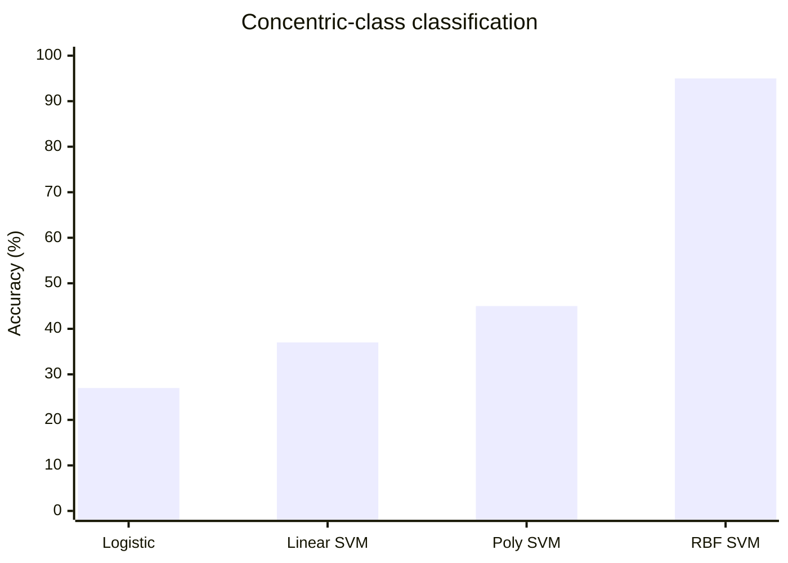

<div align="center">

# Linear Models & Kernel Methods

Regression · Regularization · Classification · Explainable AI


[Machine Learning](../README.md) · [Repository](../../README.md)


</div>

## Overview

Seven implementations exploring regression, regularization, classification and model interpretability using controlled synthetic datasets.

## Implementations

| Task | Implementation | Key concept |
|:---:|---|---|
| 0 | [Linear Regression](0-linear_regression.py) | Ordinary least squares |
| 1 | [Regression Metrics](1-regression_evaluation_metrics.py) | MSE, RMSE, MAE, R² |
| 2 | [Ridge Regression](2-ridge_regression.py) | L2 regularization |
| 3 | [Lasso Regression](3-Lasso_regression.py) | L1 regularization and feature selection |
| 4 | [SHAP](4-shap.py) | Feature-level prediction explanations |
| 5 | [Logistic Regression](5-logisitc_regression.py) | Probabilistic classification |
| 6 | [Support Vector Machines](6-svm.py) | Linear, polynomial and RBF kernels |

## Experimental Results

| Experiment | Baseline | Alternative | Key finding |
|---|---:|---:|---|
| Multicollinearity (R²) | OLS: 0.8266 | Ridge: **0.8310** | More stable coefficients are the goal of L2 |
| Feature selection (R²) | OLS: 0.4885 | Lasso: **0.8185** | 44 of 50 coefficients set to zero |

OLS baseline metrics (Task 1): **MSE 24.5471 · RMSE 4.9545 · MAE 3.6775 · R² 0.8266**.

Binary logistic regression achieved **88% accuracy** in its separate experiment.



RBF SVM achieved **95% accuracy** on the nonlinear classification example. All results are from the supplied synthetic experiments, not general performance guarantees.

## Key Concepts

| Method | Core idea |
|---|---|
| OLS | Minimize squared prediction errors |
| Ridge | Shrink coefficients using a squared-weight penalty |
| Lasso | Use an absolute-weight penalty to encourage sparse models |
| Logistic Regression | Estimate class probabilities |
| SVM | Maximize class margins; kernels enable nonlinear boundaries |
| SHAP | Explain feature contributions relative to a baseline |

## Getting Started

```bash
python -m pip install numpy scikit-learn matplotlib shap
```

Place the original assignment's `N-main.py` test scripts in this directory, then run:

```bash
python 3-main.py
```

Synthetic datasets are generated in the test scripts; no external dataset is required. Model constructors return unfitted estimators, with training and evaluation handled separately.

---

[Machine Learning](../README.md) · [Tree Models](../tree_models/README.md) · [Repository](../../README.md)
